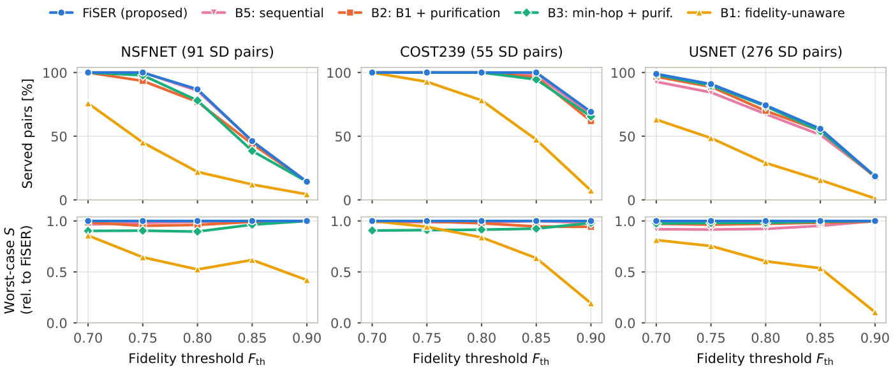

# FiSER

### Fidelity-Guaranteed Survivable Entanglement Provisioning with Purification in Space–Ground Quantum Networks

**Sooyoung Jang**<sup>1</sup> and **Eunkyung Kim**<sup>2</sup>\
<sup>1</sup> Department of Computer Engineering, Hanbat National University, Daejeon 34158, Republic of Korea\
<sup>2</sup> Department of Artificial Intelligence Software, Hanbat National University, Daejeon 34158, Republic of Korea\
Correspondence: `ekim@hanbat.ac.kr`

> **Status:** under review; the manuscript is not included. The authors declare no conflict of interest.



## Abstract

Survivable entanglement provisioning that maximizes the success probability under failures abstracts fidelity
away, so a surviving path may deliver unusable entanglement. We formulate fidelity-guaranteed survivable
entanglement provisioning (FiSER) as a mixed-integer linear program that jointly selects α+1 disjoint paths and
every link's purification level, so that each path meets an end-to-end fidelity threshold, and maximizes the
success probability guaranteed under any α intermediate-node or link failures. The model admits satellite links
as shared failure points, a weather-diversity rule, and finite memory coherence. We prove NP-completeness for
every fixed α ≥ 1 and give a heuristic with exact purification. On three reference networks with a 10 pairs/s
floor, FiSER serves up to 4.0× as many requests as a fidelity-unaware survivable design at thresholds of
0.8–0.85, up to 13% more than purifying its paths afterwards, and up to 30% more than exact sequential selection
under two failures. With 144 LEO satellites and GHz-class sources, the share of NSFNET requests servable at
fidelity 0.85, each provisioned alone, rises from 46% to 87% in night-window snapshots. The heuristic is optimal
on all but five of 12,101 served requests and up to 14× faster.

## Repository layout

```
fiser/
  physics.py       Werner states, BBPSSW purification, memory decay, per-link option tables
  network.py       quantum networks as multigraphs with option tables on the links
  topologies.py    NSFNET, COST239, USNET (sources in topology_data.py) and random meshes
  paths.py         path success and fidelity, exact purification of a fixed path
  milp.py          the FiSER MILP; sat_diverse=True gives FiSER-W
  heuristic.py     first-path-first search seeded by min-cost disjoint path sets
  methods.py       the baselines B1-B7 and the common evaluation of a request
  satellite.py     Walker constellation, look angles, Sun elevation
  spaceground.py   satellite links between optical ground stations (OGS), one snapshot at a time
  report.py        service floor and summaries
experiments/       experiment, analysis, and figure scripts; journal_runs.sh runs the experiments in stages
tests/             exactness tests against exhaustive enumeration, quantum-state checks, satellite geometry
results/journal/   raw and summary results of every run behind the paper (about 65 MB)
assets/            figure used by this README
```

Not in the repository: the manuscript, which is under review. Everything in `results/journal/` is regenerated by
the stages below.

## Installation

```bash
git clone https://github.com/pz1004/fiser.git && cd fiser
python3 -m venv .venv && . .venv/bin/activate
pip install -r requirements.txt
python -m pytest -q tests        # 45 tests, about 50 s
```

The scripts call `.venv/bin/python`, so keep the environment in `.venv` at the repository root. Results were
produced with Python 3.12.12, PuLP 2.9.0, and HiGHS 1.15.1 (`highspy`) on an Intel Core i7-14700KF, with one
HiGHS thread per request and up to 24 requests solved in parallel. No TeX installation is needed.

## Networks and parameters

| Network | Nodes | Links | Link lengths | Used for |
|---|---:|---:|---|---|
| NSFNET | 14 | 21 | DeepRMSA code release (Chen et al., 2019), without the NE–GA link | all experiments |
| COST239 | 11 | 26 | DeepRMSA code release (Chen et al., 2019) | all experiments |
| USNET | 24 | 43 | Sahoo, arXiv:2008.07255 | all experiments |
| Random meshes | 20–400 | average degree 3.5 or 3.0 | Delaunay triangulations, links of at most 100 km | scalability, joint vs sequential selection |

Each reference network is scaled so that its longest link is 100 km. The meshes come in 3 graphs with 30 SD pairs
per size; on 200 and 400 nodes, the endpoints lie within 200 km. Satellite links come from a Walker delta shell
of 144 satellites over two to six OGS placed on spread-out nodes.

Defaults are in `fiser/physics.py` (`PhysParams`) and `fiser/spaceground.py` (`SatParams`). The scripts accept
overrides such as `--param t_coh_s=0.1` and `--sat F_sat=0.87`.

| Parameter | Value | Source |
|---|---|---|
| Slot length | 1 ms | — |
| Fiber attenuation | 0.2 dB/km | Sangouard et al., Rev. Mod. Phys. 83, 33 (2011) |
| Multiplexed attempts per link and slot | 50 | Li et al., IEEE Trans. Commun. 70, 6748 (2022) |
| Heralding efficiency | 0.5 | assumption |
| Raw Werner parameter, noise length | 0.98, 500 km (link fidelities 0.85–0.98) | comparable to Zhao et al., IEEE INFOCOM 2022 |
| Swap success, swap Werner factor | 0.9, 0.99 | Shi and Qian, ACM SIGCOMM 2020; Briegel et al., PRL 81, 5932 (1998) |
| Purification | BBPSSW recurrence, up to 2 rounds | Bennett et al., PRL 76, 722 (1996) |
| Memory coherence time | ∞ (also 1, 0.1, and 0.01 s), signals at 2×10⁵ km/s | Abobeih et al., Nat. Commun. 9, 2552 (2018) |
| Service floor | 0.01 per slot (10 pairs/s) | — |
| Constellation | Walker delta 144/12/1 at 550 km and 53°, elevation at least 20° | Starlink's first shell |
| Downlinks | 810 nm, beam waist 2.5 cm, receiver radius 0.6 m, zenith transmittance 0.5, efficiency 0.25 (51–78 dB for two downlinks) | Khatri et al., npj Quantum Inf. 7, 4 (2021); Yin et al., Nature 582, 501 (2020) |
| Satellite source | 10⁶ attempts per slot (1 GHz), pair fidelity 0.91 | Khatri et al. (2021); Yin et al. (2020) |
| Operation | night only (Sun below −12°), 24 h from 2027-03-20 12:00 UTC, 5-min snapshots | Lu et al., Rev. Mod. Phys. 94, 035001 (2022) |

## Reproducing the results

Run the stages in order; `derived` reads the outputs of the others. Each stage takes less than 2 h with 24 worker
processes.

```bash
./experiments/journal_runs.sh ground        # single and two failures, memory coherence, sensitivity
./experiments/journal_runs.sh meshes        # random meshes (Table V) and the sequential-selection study
./experiments/journal_runs.sh sat_usnet     # space-ground: 24 h of 5-min snapshots
./experiments/journal_runs.sh sat_small
./experiments/journal_runs.sh sat_weather   # includes the heuristic on satellite snapshots
./experiments/journal_runs.sh sat_misc1
./experiments/journal_runs.sh sat_misc2
./experiments/journal_runs.sh sat_new
./experiments/journal_runs.sh derived       # model validation, satellite statistics, link lifetimes, outages
```

**Only the runtimes depend on the machine.** Apart from the runtime columns, reruns with the pinned package
versions reproduce `results/journal/` (checked bit for bit on the NSFNET and COST239 ground runs). The
heuristic's speedups come from those columns, so time it on an otherwise idle machine.

Every result in the paper comes from one of the scripts below; each reads `results/journal/` and applies the
service floor. Section, figure, and table numbers refer to the manuscript.

| Paper item | Command (`.venv/bin/python experiments/...`) |
|---|---|
| Figs. 2 and 3, Tables III–VI | `plot_figures.py --outdir figs` |
| Numbers in the text of Sections VI-A, VI-B, VI-D, VI-E, and VI-F, Theorem 2's condition, and the extras of Section VI-G | `paper_numbers.py` |
| Table II and the joint-versus-sequential numbers (Section VI-C) | `analyze_b5.py` |
| Space–ground shares, baselines, hardware, constellation, two failures, coherence, heuristic (Section VI-G) | `analyze_spaceground.py` |
| Weather diversity and cloud outages (Section VI-G) | `analyze_weather.py`, `analyze_weather_outages.py` |
| Model validation (Section VI-E) | `results/journal/validate_model.txt` (from `validate_model.py`) and `tests/` |
| OGS separations and satellite load | `results/journal/spaceground/stats.txt` (from `satellite_stats.py`) |
| Satellite link lifetimes and re-provisioning time | `results/journal/spaceground/link_lifetime_*.txt` (from `link_lifetime.py`) |

## Results

| | |
|---|---|
| Against the fidelity-unaware survivable design (B1) | up to 4.0× as many requests served at fidelity thresholds of 0.8–0.85; 1.0–7.1× (median 2.6×) over 48 sensitivity cases |
| Against purifying pre-selected paths | up to 13% more requests than purifying the paths of a survivable design (B2, B7) and 20% more than purifying min-hop paths (B3) |
| Against exact sequential selection (B5) | up to 10% more requests under single failures (USNET) and 30% more under two failures (NSFNET) |
| Robustness | never worse than any protected baseline; in some evaluated case, 10–21% more requests than each of B5, B2, B7, and B3 |
| LEO satellites, each request provisioned alone | NSFNET at fidelity 0.85: 46% → 87% of requests servable in night-window snapshots with GHz-class sources; 82% if no weather front may cut all paths |
| Memory coherence | 1-s memories cost at most six requests per network; 0.1-s memories cost up to 27% of the requests served at fidelity 0.8 |
| Heuristic | optimal on all but 5 of 12,101 served requests and 2.7–14× faster than the MILP |

All shares are per request: each request is provisioned alone, as in the survivable designs of Oki et al., and
the satellite shares hold at the sampled instants. Requests that compete for memories and satellite sources are
not modeled.

## Paper

The manuscript is under review and is not included here. Its Figs. 2 and 3 and Tables III–VI are regenerated by
`experiments/plot_figures.py`, and the results in its text come from the scripts listed under
*Reproducing the results*.

## Citation

```bibtex
@unpublished{jang2026fiser,
  title  = {Fidelity-Guaranteed Survivable Entanglement Provisioning with Purification
            in Space--Ground Quantum Networks},
  author = {Jang, Sooyoung and Kim, Eunkyung},
  year   = {2026},
  note   = {Manuscript under review}
}
```

## Acknowledgement

The link lengths of the reference networks come from the sources below; `fiser/topology_data.py` records them for
each network, with notes on provenance.

- X. Chen, B. Li, R. Proietti, H. Lu, Z. Zhu, and S. J. B. Yoo, "DeepRMSA: A deep reinforcement learning
  framework for routing, modulation and spectrum assignment in elastic optical networks," *J. Lightw. Technol.*,
  vol. 37, no. 16, pp. 4155–4163, 2019 (NSFNET and COST239, from its code release).
- S. Sahoo, "Research on survivability strategies of virtual network," master's thesis, Chongqing University of
  Posts and Telecommunications, 2020, arXiv:2008.07255 (USNET).

The baselines B1 and B7 reproduce the survivable designs of E. Oki, M. Maeda, and R. Shiraki, "Design of
survivable entanglement path provisioning under node failures in quantum networks," *IEEE Trans. Netw. Service
Manag.*, vol. 23, pp. 7141–7157, 2026. The satellite links follow the model of Khatri et al., *npj Quantum
Information* 7, 4 (2021). The MILPs are solved by HiGHS (Q. Huangfu and J. A. J. Hall, *Math. Program. Comput.*
10, 119–142, 2018) through PuLP.

## License

Released under the MIT License — see [`LICENSE`](LICENSE).
